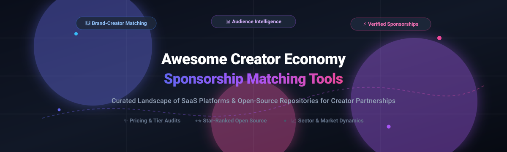

# 🌟 Awesome Creator Economy Sponsorship Matching Tools

**A curated ecosystem of SaaS platforms & open-source GitHub projects for creator sponsorships, brand-influencer matchmaking, audience intelligence, and partnership analytics.**

*Discover cutting-edge creator economy software, influencer marketing CRM tools, ROI calculators, and self-hosted open-source matching platforms.*

📅 **Last updated: March 2026**

---

## 📖 Overview

This repository tracks high-impact **SaaS platforms** and **open-source developer tools** designed for **Creator Economy Sponsorship Matching**, influencer discovery, audience analytics, campaign execution, and payout automation.

Whether you are a direct-to-consumer (DTC) brand scouting micro-creators, an agency scaling multi-channel campaigns, or an engineering team building private, self-hosted sponsorship infrastructure, this guide benchmarks enterprise SaaS solutions against open-source alternatives.

---

## 📑 Table of Contents

- [📊 Sector Overview & Market Dynamics](#-sector-overview--market-dynamics)
- [💼 SaaS/Hosted Platforms](#-saashosted-platforms)
- [🔓 Open-Source GitHub Projects](#-open-source-github-projects)
- [🛠️ Frameworks & Architecture for Custom Systems](#️-frameworks--architecture-for-custom-systems)
- [🤝 How to Contribute](#-how-to-contribute)
- [💖 Support](#-support)
- [📈 Star History](#-star-history)
- [⚠️ Disclaimer](#️-disclaimer)

---

## 📊 Sector Overview & Market Dynamics

The global creator economy sponsorship and influencer marketing sector is estimated at **$32.5B–$40B+** (heading toward a broader **$480B** creator ecosystem by 2027). The market is **highly fragmented** rather than concentrated/winner-take-all: the top ten platforms hold under 30% of aggregate industry revenue, driven by a massive long tail of over 50 million creators and decentralized brand spend across micro and nano partnerships.

---

## 💼 SaaS/Hosted Platforms

The table below outlines leading commercial platforms, ranked descending by estimated company valuation / annual recurring revenue (ARR), with transparent starting tier pricing and specific free trial / plan quotas:

| Platform | Company Size (Valuation / Est. Revenue) | Starting Price | Free Tier / Trial Limits | Description |
| :--- | :--- | :--- | :--- | :--- |
| **[Impact.com](https://impact.com/)** | **$1.5B valuation** (~$270M+ ARR) | $30/mo (Shopify Starter) or $500/mo (Essentials) | 30-day free trial on self-serve starter plans (credit card required, capped discovery/tracking features) | Enterprise partnership management platform covering affiliates, influencers, and B2B partnerships. Features attribution, contract management, and payment processing. |
| **[Grin](https://grin.co/)** | **~$1.0B valuation** (~$35M–$55M ARR) | $200/mo (Starter plan, billed annually) | Free-for-ever tier with 5 creator relationship profiles & limited discovery credits; 30-day free trial for Starter features | All-in-one creator management platform for e-commerce brands. Combines creator discovery, outreach, campaign execution, and reporting with Shopify integration. |
| **[CreatorIQ](https://www.creatoriq.com/)** | **~$400M–$500M est. val** (~$70M–$100M ARR; $80M+ raised) | $2,500/mo ($30,000/yr billed annually) | 14-day guided proof-of-concept trial via sales qualification (access limited to 1 user and 25 search lookups) | Enterprise influencer marketing platform powered by data science. Features AI-powered creator discovery, campaign management, and enterprise-grade talent CRM. |
| **[Captiv8](https://captiv8.io/)** | **$150M acquisition valuation** (by Publicis Groupe; ~$25M ARR) | $2,083/mo ($25,000/yr billed annually) | 7-day sales-approved sandbox trial (capped at 50 creator profile analyses and 1 campaign draft) | Creator marketing platform with audience intelligence, creator discovery, and campaign measurement. Features social listening and brand safety tools. |
| **[Traackr](https://www.traackr.com/)** | **~$100M est. val** (~$20M–$25M ARR; $20M raised) | $1,667/mo ($20,000/yr billed annually) | 14-day trial available upon enterprise consultation (limited to 10 creator analyses and 1 sample benchmark report) | Influencer relationship management platform. Features creator discovery, campaign tracking, and performance analytics across social platforms. |
| **[Aspire](https://www.aspireiq.com/)** | **~$80M–$120M est. val** (~$15M–$20M ARR; $30M+ raised) | $2,500/mo ($30,000/yr billed annually) | Free-for-ever account for creators/influencers (100% free with unlimited incoming briefs); 14-day pilot for qualified brand demos | Creator marketing platform for building brand communities and tracking ROI. Features creator discovery, campaign management, and content analytics. |
| **[Upfluence](https://www.upfluence.com/)** | **~$60M–$80M est. val** (~$20M–$25M ARR) | $478/mo (billed annually on 12-month agreement) | Free Chrome browser extension (up to 20 profile analyses/month); custom 7-day pilot trial following sales demo | All-in-one influencer and affiliate marketing platform for e-commerce. Features creator discovery, Creator Lookalikes, AI Mailing Assistant, and affiliate tracking. |
| **[Modash](https://www.modash.io/)** | **~$50M est. val** (~$10M ARR; $14M raised) | $199/mo (billed annually) or $299/mo (billed monthly) | 14-day free trial (no credit card required, includes 100 creator profile views and 10 export credits) | End-to-end influencer marketing SaaS platform built for Shopify brands. Features creator discovery, campaign management, content tracking, affiliate management, and creator payments. Serves 1,900+ B2C influencer marketing teams globally. |
| **[NeoReach](https://neoreach.com/)** | **~$20M–$30M est. val** (~$4M–$5M ARR; $4.3M raised) | $2,083/mo ($25,000/yr billed annually) | 14-day structured sandbox trial upon demo request (capped at 10 creator searches and 3 report exports) | Influencer marketing platform with creator discovery, campaign management, and analytics. Features audience demographics and engagement scoring. |
| **[Creator.co](https://creator.co/)** | **~$6M–$10M est. val** (~$4M ARR; $1.9M raised) | $299/mo (Self-serve plan) | 7-day limited test trial upon request (view-only marketplace access; maximum 5 creator invites) | Creator marketplace and campaign management platform connecting brands with creators for UGC and influencer campaigns. |

---

## 🔓 Open-Source GitHub Projects

Open-source alternatives provide customizable pipelines, fraud resistance, decentralized monetization, and direct affiliate/referral tracking without vendor lock-in. 

*Repositories are sorted in descending order by GitHub star count:*

1. **[Affitor / affiliate-skills](https://github.com/Affitor/affiliate-skills)**   
   🚀 50+ AI agent skills for affiliate marketing automation. Powers research on trending creator content, data-backed promotional copywriting, infographic generation, and automated affiliate funnels compatible with Claude Code, Cursor, ChatGPT, and Gemini.

2. **[amicalhq / refref](https://github.com/amicalhq/refref)**   
   🎯 Open-source referral and affiliate marketing platform built with TypeScript, Next.js, PostgreSQL, Redis, and BullMQ (AGPLv3). Features JavaScript attribution snippets, customizable partner reward structures, fraud detection, and an affiliate/creator self-service portal.

3. **[Refferq / Refferq](https://github.com/Refferq/Refferq)**   
   💳 Modern open-source referral and affiliate marketing platform tailored for SaaS companies (MIT). Built with Next.js 15, React 19, Prisma, and Tailwind CSS. Provides commission automation, payout scheduling (PayPal, Stripe, Wise), affiliate dashboards, and branded tracking assets.

4. **[AOSSIE-Org / InPactAI](https://github.com/AOSSIE-Org/InPactAI)**   
   🤖 AI-powered open-source matchmaking engine connecting content creators, brands, and marketing agencies. Employs generative AI, audience analytics, and engagement metrics to estimate sponsorship pricing and maximize partnership ROI.

5. **[sdntsng / sheety-crm](https://github.com/sdntsng/sheety-crm)**   
   📋 Lightweight, stateless open-source CRM built directly on Google Sheets (MIT). Features Kanban pipelines, creator lead management, and activity tracking—ideal for early-stage creator outreach without infrastructure overhead.

6. **[oratis / influencex](https://github.com/oratis/influencex)**   
   📊 Open-source KOL (Key Opinion Leader) and influencer marketing platform built with React, Node.js, and PostgreSQL. Supports multi-platform creator cataloging, automated outreach workflows, and campaign conversion tracking.

7. **[district0x / StreamTide](https://github.com/district0x/StreamTide)**   
   🌊 Web3-based decentralized patronage and grant-matching platform designed to amplify community financial support for digital creators through quadratic and pooled funding mechanisms.

8. **[alphoder / Dashh](https://github.com/alphoder/Dashh)**   
   🛡️ Decentralized influencer marketing platform built on Solana utilizing zkTLS zero-knowledge proofs and Reclaim Protocol. Brands post campaigns via Solana Actions (Blinks) and verify creator deliverables and views trustlessly without accessing private credentials.

9. **[rebin03 / CollabX](https://github.com/rebin03/CollabX)**   
   🤝 Full-lifecycle influencer collaboration system built with Django and Python (MIT). Manages creator discovery by niche, campaign brief applications, proposal reviews, milestones, and secure escrow payouts via Razorpay.

10. **[OmAmar106 / Influencer-Sponsorship-Engagement-System](https://github.com/OmAmar106/Influencer-Sponsorship-Engagement-System-23f2002152)**   
    📦 Complete sponsorship campaign and contract workflow system connecting brand sponsors with social influencers for deliverable tracking, proposal negotiations, and engagement evaluation.

11. **[DevFund](https://www.linkedin.com/posts/krishna-khandelwal-470b30280_devfund-buildinpublic-opensource-activity-7438461523926175744-6Yqi)**   
    💡 Developer-focused sponsorship platform supporting open-source maintainers through monthly tier-based sponsorship, private repository access, and exclusive milestone previews.

---

## 🛠️ Frameworks & Architecture for Custom Systems

Building your own vendor-independent creator sponsorship stack? Consider combining:
- **Discovery & AI Pricing**: Integrate **[InPactAI](https://github.com/AOSSIE-Org/InPactAI)** for engagement evaluation and match scoring.
- **Workflow & Escrow Execution**: Deploy **[CollabX](https://github.com/rebin03/CollabX)** for application handling and payout escrow.
- **Fraud Prevention**: Leverage **[Dashh](https://github.com/alphoder/Dashh)** with zkTLS / Reclaim Protocol for zero-knowledge creator verification.
- **Affiliate & Referral Engine**: Embed **[refref](https://github.com/amicalhq/refref)** or **[Refferq](https://github.com/Refferq/Refferq)** for granular attribution and conversion-based payouts.
- **AI Agent Automation**: Implement **[affiliate-skills](https://github.com/Affitor/affiliate-skills)** to automate outreach copy and campaign collateral.

---

## 🤝 How to Contribute

Contributions are warmly encouraged! Help keep this ecosystem resource comprehensive, up-to-date, and accurate:

1. 🍴 **Fork** the repository.
2. 🌿 Create your feature branch (`git checkout -b feature/add-new-tool`).
3. 📝 Update [`README.md`](README.md) following the existing tabular or ranked badge format:
   - Provide direct official links.
   - For SaaS tools: include exact starting price tiers, free trial/tier constraints, and valuation/revenue estimates.
   - For Open-Source projects: provide the GitHub repository link, star badge (`style=social&color=white`), and an architectural summary.
4. 🚀 Commit your changes (`git commit -m 'Add ToolName to ecosystem'`).
5. 📬 Open a **Pull Request** with context on why the addition adds value to creator economy professionals.

---

## 💖 Support

If you found this curated list helpful for your brand, agency, or open-source software stack, please consider showing your support:

- ⭐ **Star this repository** to help others discover it across GitHub.
- 🍴 **Fork and share** it with your fellow marketers, developers, and founders.
- ☕ **Buy me a coffee / Sponsor**: Support ongoing maintenance and curation on the [Sponsor Dashboard](https://github.com/sponsors/ishandutta2007).

---

## 📈 Star History

---

## ⚠️ Disclaimer

- This repository is a **community-curated index** created for educational, research, and benchmarking purposes. Inclusion does not imply official endorsement.
- Platforms handling influencer, creator, and audience personal data must adhere strictly to global data protection laws (GDPR, CCPA) and regional advertising disclosure regulations (e.g., FTC Endorsement Guides).
- Pricing tiers, free trial terms, and corporate valuations fluctuate over time; always confirm directly with respective service providers.

---

  <b>Built for creator marketing teams, brand partnership directors, and open-source engineers.</b> 
  Let's make Creator Economy Sponsorship Matching transparent, accessible, and data-driven.

